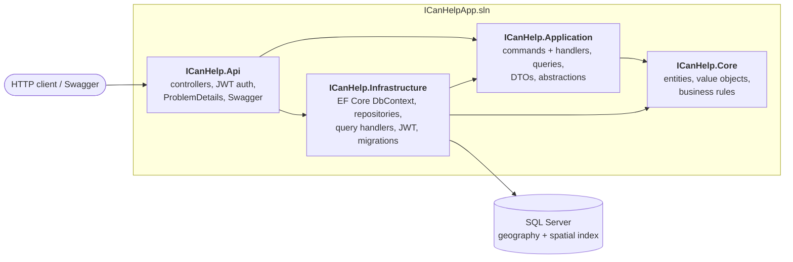
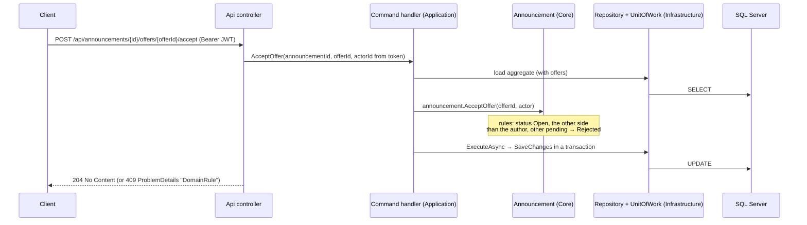
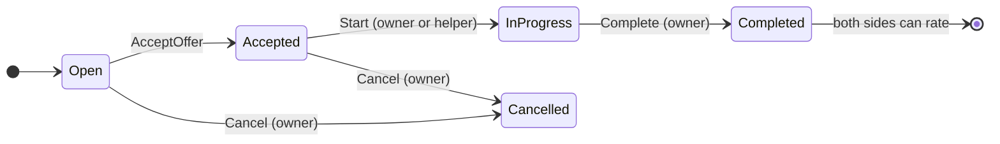
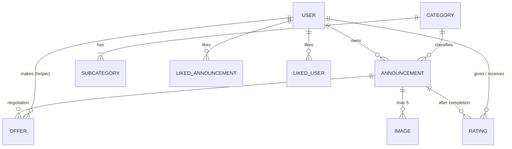

# ICanHelp

[](https://github.com/RafalDev-Csharp/ICanHelp-EFCore/actions/workflows/ci.yml)

A neighbourhood help marketplace – backend in **.NET 9 / ASP.NET Core / EF Core / SQL Server**.

A **client** posts a small job (a leaking tap, painting a wall, hanging a picture, some advice).
A **helper** who knows the trade – ideally someone who passes nearby on the way home from work – makes an offer
with a price. Both sides can negotiate with counter-offers. The client accepts the best offer, the job gets done
and both sides rate each other. One account can be a client in one deal and a helper in another.

## Features

* Sign-up / sign-in with **JWT** (passwords hashed with ASP.NET Core Identity's PBKDF2 hasher)
* Announcements with categories, budget, location and up to 5 images
* Negotiation: offers, counter-offers, accept / reject / withdraw – rules enforced in the domain model
* Contact details of the other side revealed only after an offer is accepted
* Work lifecycle: start → complete → mutual ratings (once per announcement)
* **"Near me" search** – SQL Server `geography` column + spatial index, results sorted by distance
* Errors always as **ProblemDetails** (RFC 9457) with an `errorCode` and `traceId`
* Unit tests (domain, handlers) and **integration tests on a real SQL Server (Testcontainers)**, run in **GitHub Actions**

## Architecture

Clean Architecture – dependencies point inwards, the domain (`Core`) depends on nothing.



**CQRS without a mediator.** Commands are handled in `Application` (repositories + `IUnitOfWork`, which wraps
`SaveChanges` in a transaction). Queries are defined in `Application` but handled in `Infrastructure`,
because they read straight from the `DbContext` (`AsNoTracking`) and project to DTOs.



## Domain



Offers: `Pending` → `Accepted` | `Rejected` | `Withdrawn` | `Countered` (replaced by a counter-offer pointing to it).
Accept / reject / counter is always done by the **other side** than the offer's author; only the author can withdraw.



## Getting started

Requirements: .NET 9 SDK, Docker.

```bash
docker compose up -d                 # SQL Server 2022 on localhost:1433
dotnet tool restore                  # dotnet-ef from the tool manifest
dotnet run --project ICanHelp.Api    # migrations + category seed run on startup
```

Swagger: <http://localhost:5080/swagger> (Development only). Example requests for the whole flow are in
[`ICanHelp.Api/ICanHelp.Api.http`](ICanHelp.Api/ICanHelp.Api.http).

Outside Development you must set `Auth__SigningKey` (≥ 32 bytes) and `ConnectionStrings__DefaultConnection`.

## Tests

```bash
dotnet test                                   # everything (integration tests need Docker running)
dotnet test --filter "Category!=Integration"  # unit tests only, no Docker
```

| Project | What it tests |
|---|---|
| `ICanHelp.Core.Tests` | domain rules of the `Announcement` aggregate (offers, statuses, participants) |
| `ICanHelp.Application.Tests` | command handlers with hand-written fakes, query validation |
| `ICanHelp.Api.Tests` | the whole API over HTTP (`WebApplicationFactory`) on a real SQL Server started by **Testcontainers**: migrations + seed, auth, privacy rules, the full negotiation flow, distance search on `geography` |

xUnit + Shouldly. CI (`.github/workflows/ci.yml`) builds the solution and runs unit and integration tests
on every push and pull request.

## Project structure

```text
ICanHelpApp
├── ICanHelp.Core               domain: entities, value objects, enums, exceptions, repository interfaces
├── ICanHelp.Application        commands + handlers, queries, DTOs, security / time abstractions
├── ICanHelp.Infrastructure     EF Core (DbContext, configurations, migrations), repositories, query handlers, JWT
├── ICanHelp.Api                ASP.NET Core Web API
├── ICanHelp.Core.Tests
├── ICanHelp.Application.Tests
├── ICanHelp.Api.Tests          integration tests (Testcontainers)
└── docker-compose.yml          local SQL Server
```
